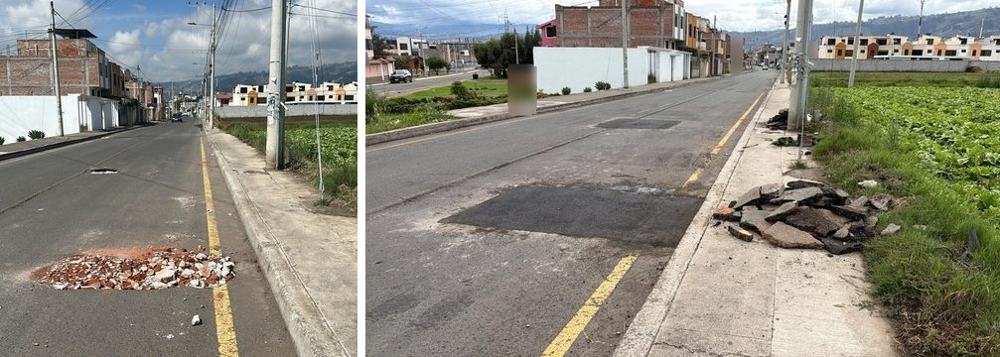
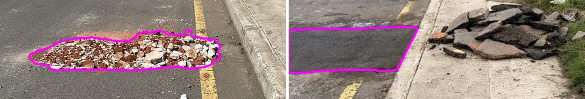
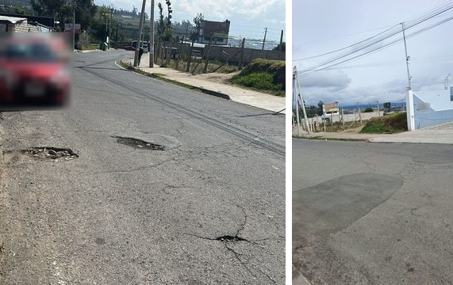
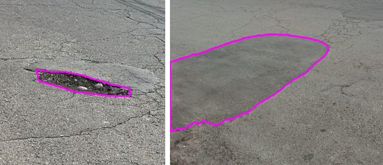
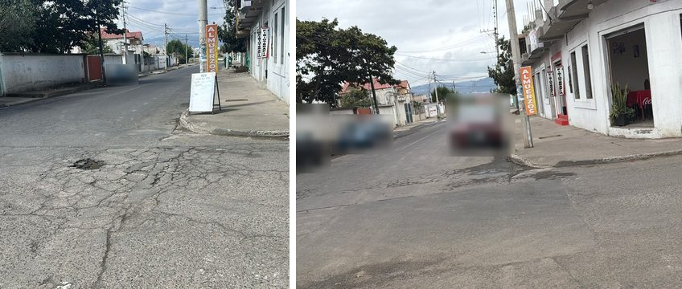
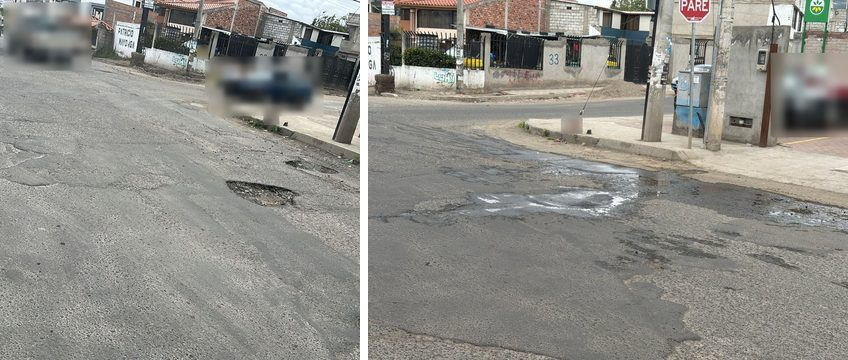
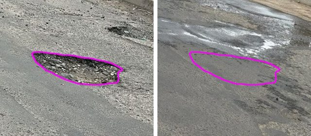

# CivicPulse

**Report any city problem with a photo. Meta's SAM 3.1 and Muse Spark check it, neighbors confirm it, and the city closes it, with AI that never calls a problem "fixed" when in doubt.**

Built for the [Meta Global AI Developer Hackathon](https://cerebralvalley.ai/e/meta-ai-developer-hackathon), track *Build for Your World*. Pilot city: Ambato, Ecuador.

> **Hackathon provenance.** Every line of code in this repository was written during the
> building period (Oct 27 – Nov 4, 2026). Before the event we only did research and design:
> a Colab notebook testing SAM 3.1 on pothole photos, and design documents (plan,
> architecture, API contract, database diagram, UX flows). See
> [docs/HACKATHON.md](docs/HACKATHON.md) for exactly what existed before, what was built
> during the event, and a day-by-day log. The git history is the record.

## How it works

```
citizen (PWA, es/en) ──► Supabase (Postgres + PostGIS + RLS, Storage, Auth)
                               │ Database Webhook
                               ▼
                    Orchestrator (FastAPI on Modal)
     received ─► spec_ready ─► vision_done ─► clustered ─► validated ─► dispatched ─► resolved
                   │              │                                        ▲
         Muse Spark 1.3      SAM 3.1 masks +                     before/after check:
         text → spec JSON    Muse Spark crop check               SAM 3.1 on both photos,
                                                                 homography, classifier,
                                                                 asymmetric decision
```

1. **Report.** A citizen describes the problem in any language and takes a live photo. No account: an anonymous session is the device identity.
2. **Understand.** Muse Spark turns the text into an English spec (category, severity, what it looks like) merged with a curated catalog of 21 civic categories.
3. **See.** SAM 3.1 segments what the spec describes; Muse Spark checks each crop. A photo never rejects a report; it only adds evidence. Faces and plates are blurred before anything is public.
4. **Agree.** Reports cluster in space; weighted consensus (device trust, distinct devices, reused-photo and GPS checks) validates a cluster.
5. **Route.** Validated clusters go to the responsible stakeholder with a brief that cites real reports and places.
6. **Close.** An after photo is aligned to the before photo; SAM 3.1 and Muse Spark compare the same region. Doubt (shadow, water, occlusion, bad alignment) never becomes "resolved".

## Meta models

| Model | Where | Role |
|---|---|---|
| **SAM 3.1** | Meta Model API (fallback: official weights on a Modal GPU) | Where the problem is, counting people, anonymization |
| **Muse Spark Open** | Baseten (hackathon credits; fallback hosts Fireworks / Modal Endpoints) | Text → spec, crop and before/after classification, briefs |
| **Muse Spark 1.3** | Meta Model API | Second provider for the same prompts (Meta credits are kept for SAM 3.1) |
| **Muse Glimmer** | Open weights | Cheap last model fallback; after it, catalog keywords and human review |

## Results on real data

Closure check on anonymized before/after pothole repairs from a public entity in Ambato, labeled
by hand, plus synthetic negatives (`scripts/eval_closure.py --gps`, 84 runs, about USD 1.63 of
Meta credits, 2026-11-01). Full table and the comparison with the previous run:
[docs/eval/closure_eval_2026-11-01.md](docs/eval/closure_eval_2026-11-01.md). After the AFTER crop started outlining the
repair patch itself, the aligned sets were run again (44 runs, about USD 0.86): still 0 / 24 false
"resolved" ([docs/eval/closure_eval_2026-11-02.md](docs/eval/closure_eval_2026-11-02.md)).

| | Result |
|---|---|
| False "resolved" on cases that are not fixed (goal 0) | **0 / 44** |
| Another place's repair, said near by GPS (worst case) | 0 / 20 candidates |
| Real repairs sent to a human as "looks fixed" | 5 / 20 (4 / 20 on the re-run of 2026-11-02) |
| The rest of the real repairs | "cannot verify" (other angle, blur): a human decides |

The AI never closes a case: at best it marks a candidate, and a person approves it.

### Four real repairs, four honest answers

All photos are anonymized (faces, people and close vehicles blurred, no metadata). Each pair is
the BEFORE photo from the report and the AFTER photo from the repair crew.

| Pair | What the system said | Why |
|---|---|---|
| **bach_0211** | Candidate, a human confirms | Photos aligned; the AFTER crop outlines the new asphalt patch next to the hole, with its own shape; Muse: no issue (0.96) |
| **bach_0007** | Candidate, a human confirms | Shot from another angle, so no alignment; the AFTER GPS is close, SAM finds the patch, Muse says no issue and that both photos show the same place |
| **bach_0209** | Cannot verify | Another angle and a weak match: the system will not guess, a human decides |
| **bach_0051** | Cannot verify | Aligned, but something covers part of the region (confuser or occlusion) |

**bach_0211**, before and after, then the region the classifier compared (left BEFORE, right AFTER):




**bach_0007**, before and after, then the region check:




**bach_0209**, before and after:



**bach_0051**, before and after, then the region check:




Try these same pairs in the judges' sandbox at `/sandbox`.

## Repository

| Path | What |
|---|---|
| `apps/web` | Next.js PWA: public map, `/report`, `/sandbox`, `/panel`, open GeoJSON feed. UI in Spanish and English |
| `services/orchestrator` | Python: webhook API, LLMRouter, SAMService, intake pipeline, closure decision, Modal app |
| `supabase` | Migrations (schema, RLS, RPCs, storage), seeds, SQL tests |
| `packages/catalog` | Civic category catalog (seed of the `categories` table) |
| `packages/contracts` | API contract (OpenAPI) and JSON Schemas shared by web and orchestrator |
| `domains` | Domain packs (transit, roads, water, general): stakeholders and closed action lists |
| `data/pothole_pairs` | Anonymized index of 1,079 real before/after pothole pairs from Ambato (evaluation) |
| `scripts` | Catalog sync, DB test runner |

## Run it

```bash
# Orchestrator tests
cd services/orchestrator && pip install -e ".[dev]" && pytest

# Database: any empty Postgres 16 + PostGIS
DATABASE_URL=postgres://postgres@localhost:5432/cp_test scripts/test_db.sh
# or the full local Supabase stack
supabase start && supabase db reset

# Web
cd apps/web && npm ci && npm run dev
```

Copy `.env.example` to `.env` and fill in the keys. Production: Vercel (web), Supabase (data), Modal (orchestrator).

## Data and privacy

- Citizens are anonymous. Raw photos stay in a private bucket; only anonymized copies (faces and plates blurred, EXIF removed) can be public.
- The Ambato pothole pairs are used with the data owner's permission. Names, phone numbers, source ids and exact coordinates never enter this repository; see [data/pothole_pairs/README.md](data/pothole_pairs/README.md).
- The Meta Model API only receives anonymized photos and redacted text: people, faces and plates are blurred locally (SAM 3.1 open weights) before any API call.

## License

MIT
